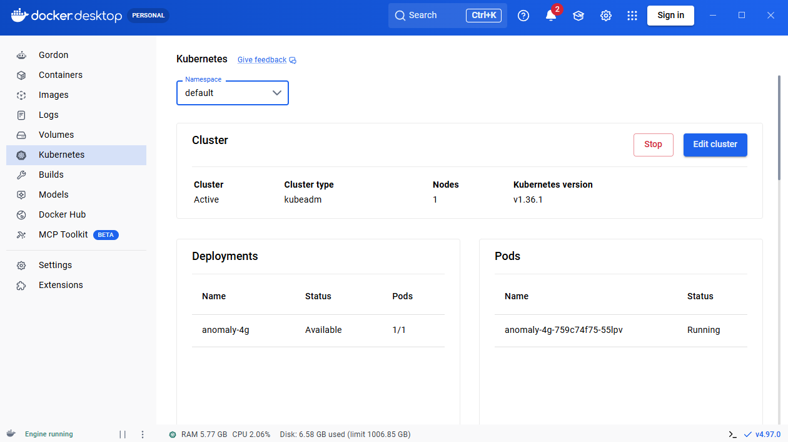
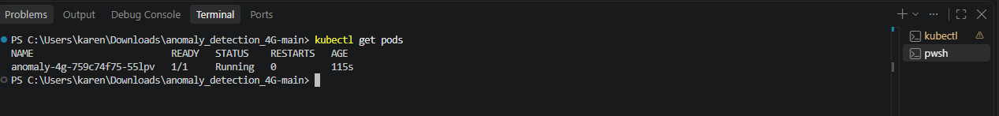
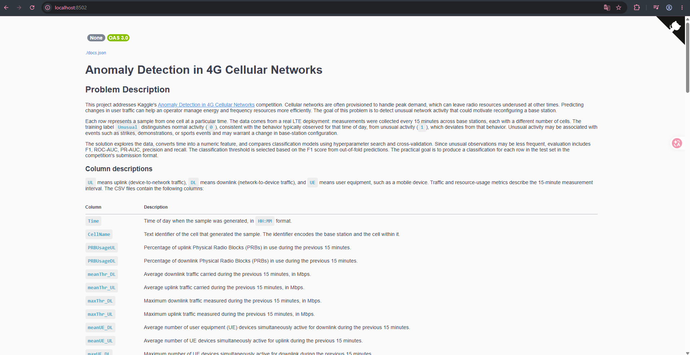
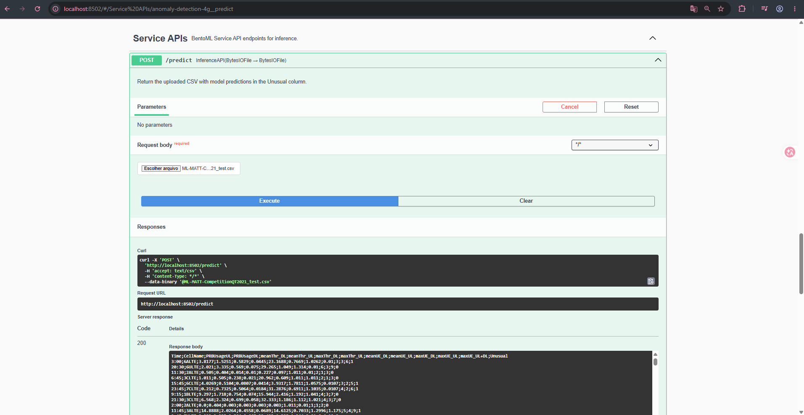

# Anomaly Detection in 4G Cellular Networks

## Problem Description

This project addresses Kaggle's [Anomaly Detection in 4G Cellular Networks](https://www.kaggle.com/competitions/anomaly-detection-in-4g-cellular-networks/discussion?sort=recent-comments) competition. Cellular networks are often provisioned to handle peak demand, which can leave radio resources underused at other times. Predicting changes in user traffic can help an operator manage energy and frequency resources more efficiently. The goal of this problem is to detect unusual network activity that could motivate reconfiguring a base station.

Each row represents a sample from one cell at a particular time. The data comes from a real LTE deployment: measurements were collected every 15 minutes across base stations, each with a different number of cells. The training label `Unusual` distinguishes normal activity (`0`), consistent with the behavior typically observed for that time of day, from unusual activity (`1`), which deviates from that behavior. Unusual activity may be associated with events such as strikes, demonstrations, or sports events and may warrant a change in base-station configuration.

The solution explores the data, converts time into a numeric feature, and compares classification models using hyperparameter search and cross-validation. Since unusual observations may be less frequent, evaluation includes F1, ROC-AUC, PR-AUC, precision and recall. The classification threshold is selected based on the F1 score from out-of-fold predictions. The practical goal is to produce a classification for each row in the test set in the competition's submission format.

### Column descriptions

`UL` means uplink (device-to-network traffic), `DL` means downlink (network-to-device traffic), and `UE` means user equipment, such as a mobile device. Traffic and resource-usage metrics describe the 15-minute measurement interval. The CSV files contain the following columns:

| Column | Description |
| --- | --- |
| `Time` | Time of day when the sample was generated, in `HH:MM` format. |
| `CellName` | Text identifier of the cell that generated the sample. The identifier encodes the base station and the cell within it. |
| `PRBUsageUL` | Percentage of uplink Physical Radio Blocks (PRBs) in use during the previous 15 minutes. |
| `PRBUsageDL` | Percentage of downlink Physical Radio Blocks (PRBs) in use during the previous 15 minutes. |
| `meanThr_DL` | Average downlink traffic carried during the previous 15 minutes, in Mbps. |
| `meanThr_UL` | Average uplink traffic carried during the previous 15 minutes, in Mbps. |
| `maxThr_DL` | Maximum downlink traffic measured during the previous 15 minutes, in Mbps. |
| `maxThr_UL` | Maximum uplink traffic measured during the previous 15 minutes, in Mbps. |
| `meanUE_DL` | Average number of user equipment (UE) devices simultaneously active for downlink during the previous 15 minutes. |
| `meanUE_UL` | Average number of UE devices simultaneously active for uplink during the previous 15 minutes. |
| `maxUE_DL` | Maximum number of UE devices simultaneously active for downlink during the previous 15 minutes. |
| `maxUE_UL` | Maximum number of UE devices simultaneously active for uplink during the previous 15 minutes. |
| `maxUE_UL+DL` | Maximum number of UE devices simultaneously active during the previous 15 minutes, regardless of uplink or downlink. |
| `Unusual` | Training target: `1` for an unusual observation and `0` otherwise. This column is not present in the test file. |

## Data

The competition data files are not included in this repository. To obtain them:

1. Sign in to the [Kaggle competition page](https://www.kaggle.com/competitions/anomaly-detection-in-4g-cellular-networks/discussion?sort=recent-comments) and accept the competition rules to enable downloads.
2. Download the data from the competition's **Data** section.
3. Extract these two files into the same folder as `notebook.ipynb`:

	- `ML-MATT-CompetitionQT2021_train.csv`
	- `ML-MATT-CompetitionQT2021_test.csv`

The notebook reads the CSV files using `;` as the delimiter. The training set contains the `Unusual` label; the test set does not. Do not redistribute the competition data if Kaggle's rules prohibit it.

You can also download the files using the Kaggle CLI after installing it and configuring your credentials as described in the [Kaggle API documentation](https://github.com/Kaggle/kaggle-api):

```bash
kaggle competitions download -c anomaly-detection-in-4g-cellular-networks
```

Extract the downloaded ZIP file into the project folder. If the competition is unavailable to your account through the CLI, download the data from the competition page after accepting the rules.

The notebook is for local project execution only. Do not include or upload a notebook as part of the competition submission; submit only the required CSV file.

## Environment setup

Use Python 3.9 or newer. From the project folder, create and activate a virtual environment, then install the dependencies:

**Windows (PowerShell):**

```powershell
python -m venv .venv
.\.venv\Scripts\Activate.ps1
python -m pip install --upgrade pip
python -m pip install -r requirements.txt
```

**macOS/Linux:**

```bash
python3 -m venv .venv
source .venv/bin/activate
python -m pip install --upgrade pip
python -m pip install -r requirements.txt
```

When the environment is active, its name (usually `.venv`) appears in the terminal prompt. To leave it, run:

```bash
deactivate
```

## Train and save the final model with BentoML

With the virtual environment active and the training CSV in the project folder, run:

```bash
python train.py
```

By default, the script reads `ML-MATT-CompetitionQT2021_train.csv` from the project folder. To use a different location or BentoML model name:

```bash
python train.py --data path/to/ML-MATT-CompetitionQT2021_train.csv --model-name anomaly_detection_4g_lgbm
```

The script applies the notebook's data preparation, chooses the classification threshold from three-fold out-of-fold predictions, then fits the selected LightGBM configuration on all cleaned training rows. BentoML saves the trained model in its local model store; the command prints the resulting model tag. The saved model also includes the chosen threshold and ordered feature names as custom objects.

## Serve predictions with BentoML

After training the model, start the BentoML API from the project folder:

```powershell
bentoml serve predict:service --reload
```

The service loads the latest model named `anomaly_detection_4g_lgbm` from
BentoML's local model store. If you trained with a different `--model-name`,
set `BENTOML_MODEL_TAG` to that model's tag before starting the service, for
example:

```powershell
$env:BENTOML_MODEL_TAG = "my_anomaly_model:latest"
bentoml serve predict:service --reload
```

Upload a CSV file as a multipart file to `http://localhost:3000/predict`. The
response is the original CSV with predictions appended in the `Unusual`
column. 

## Build the Bento and Docker Image

```powershell
bentoml build
bentoml list
```

### Windows Troubleshooting: CRLF Line Endings

On some Windows environments, BentoML may generate shell scripts such as `install.sh` using Windows-style line endings (CRLF) instead of Unix-style line endings (LF).

This may cause the following error when building the Docker image:

```text
set: pipefail: invalid option name
exit code: 2
```

To fix this issue, run the following command in PowerShell after `bentoml build` and before `bentoml containerize`:

```powershell
@'
from pathlib import Path
import bentoml

bento = bentoml.get("anomaly-detection-4g:latest")
root = Path(bento.path)

for script in root.rglob("*.sh"):
    content = script.read_bytes()

    if b"\r\n" in content:
        script.write_bytes(content.replace(b"\r\n", b"\n"))
        print("Fixed:", script)
    else:
        print("Already LF:", script)
'@ | python -
```

This converts CRLF line endings to LF in the generated Bento shell scripts without modifying the original project files.

After applying the fix, build the Docker image:

```powershell
bentoml containerize anomaly-detection-4g:latest -t anomaly-4g:latest
```

**Note:** This is a workaround for Windows-specific line-ending issues. If a new Bento is generated, the conversion may need to be repeated.

**Note:** If the output of `bentoml build` shows a different Bento name, replace `anomaly-detection-4g:latest` with the tag it reports. The `-t` option assigns the name `anomaly-4g:latest` to the Docker image.

The Bento packages the latest model version specified in `bentofile.yaml`. To pin a specific version, replace `:latest` in the `models:` field with the tag printed during training.

## Run the API Inside Docker

```powershell
docker run --rm --name anomaly-4g-api -p 3000:3000 anomaly-4g:latest serve
```

With the container running, open `http://localhost:3000` to access the API interface. 

To stop the container, press Ctrl+C in the terminal where it is running.

---

## Cloud Deployment — Local Kubernetes (Docker Desktop)

The BentoML inference API is deployed to a **local Kubernetes cluster** using
Docker Desktop. The deployment runs the `anomaly-4g:latest` container image and
exposes the BentoML HTTP server, which listens on **port 3000** inside the Pod.
The API is accessed locally through Kubernetes port forwarding on **port 8502**.

> **Deployment scope:** This is a local Kubernetes deployment, not a publicly
> hosted cloud service. It demonstrates Kubernetes orchestration and a working
> inference endpoint without requiring a cloud provider.

### Prerequisites

- Docker Desktop running on Windows, with Kubernetes enabled and the local
  `docker-desktop` context available.
- The Docker image `anomaly-4g:latest` already built, as described above.
- `kubectl` installed and accessible from PowerShell.
- The Docker image must be available to the Kubernetes node. For a Docker
  Desktop cluster using the Docker image store, `imagePullPolicy: Never` allows
  the local image to be used. Other cluster types, including `kind`, may need
  the image to be loaded into their nodes first.

### Kubernetes deployment configuration

The Kubernetes manifest is stored in [`k8s/deployment.yaml`](k8s/deployment.yaml).
It defines:

- A **Deployment** named `anomaly-4g` with one replica of the inference API.
- A **ClusterIP Service** named `anomaly-4g` routing to container port `3000`.

### Deploy and verify

From the repository root, run in PowerShell:

```powershell
kubectl config use-context docker-desktop
kubectl apply -f k8s/deployment.yaml
kubectl rollout status deployment/anomaly-4g
kubectl get pods
kubectl get services
```

**Observed result:** Docker Desktop shows an active local **kubeadm** Kubernetes
cluster with **one node** (Kubernetes v1.36.1). The `anomaly-4g` Deployment is
**Available** with **1/1** Pods, and the Pod status is **Running**.



*Figure 1 — Docker Desktop confirms that the local Kubernetes cluster is active, the `anomaly-4g` Deployment is available (1/1), and its Pod is running.*

The PowerShell verification also showed `READY 1/1`, `STATUS Running`, and `0`
restarts:



*Figure 2 — `kubectl get pods` confirms the anomaly detection API is running in the local Kubernetes cluster.*

### Access the API

Forward local port `8502` to the Kubernetes Service's port `3000`:

```powershell
kubectl port-forward service/anomaly-4g 8502:3000
```

Leave this terminal open and visit **http://localhost:8502**. The BentoML API
interface documents the project and lists the `/predict` inference endpoint.



*Figure 3 — The BentoML inference API is accessible through Kubernetes port forwarding at `localhost:8502`.*

### Test the prediction endpoint

The API accepts a test CSV file and returns CSV data with an `Unusual` prediction
column. You can test the `POST /predict` endpoint in the BentoML browser
interface (**Try it out → Choose file → Execute**) or from another PowerShell
terminal:

```powershell
curl.exe -X POST "http://localhost:8502/predict" -H "accept: text/csv" -H "Content-Type: */*" --data-binary "@ML-MATT-CompetitionQT2021_test.csv" -o predictions.csv
```

The test shown below returned **HTTP 200**, and the response body contained CSV
rows with the predicted `Unusual` column.



*Figure 4 — Successful inference request to `POST /predict` with an HTTP 200 response and CSV predictions.*

### Useful troubleshooting commands

```powershell
kubectl get pods
kubectl logs deployment/anomaly-4g --tail=50
kubectl describe deployment anomaly-4g
```

If port forwarding reports `connection refused`, verify that the application is
listening on port `3000` and that the Kubernetes Service's `targetPort` is also
`3000`. If the Pod reports `ErrImageNeverPull`, confirm that the image is
available to the Kubernetes node.
